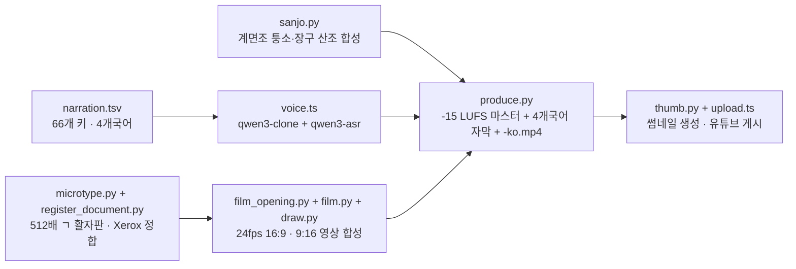

# 유니코드 연대기 파이프라인과 산조 합성

> [!info] 요약
> `episodes/unicode-1.0/`은 1991~1992년 유니코드 초판 인쇄물 질감과 연속 광학 줌을 구현하기 위해 Remotion 대신 `24 fps` Python 아카이브 합성기와 TypeScript 음성·업로드 모듈을 결합한 독립 파이프라인을 사용한다.
> 오프닝은 단일 미세 활자판(`PEAK_SCALE = 512`)으로 짠 한글 `ㄱ`(`U+3131`)에서 조 베커의 `Unicode 88` 제안서 속 `Xerox`의 `X` 획으로 끊김 없이 줌아웃하며(`scan-glyph-zoom`), 배경 음악은 물리 모델링으로 직접 합성한 계면조 퉁소·장구 산조(`sanjo.py`)를 내레이션과 사이드체인 믹싱해 `-15 LUFS`로 마스터링한다.

## 내용

### 전체 제작 파이프라인 흐름 (`24 fps`)

1. **다국어 대본 테이블 (`episodes/unicode-1.0/narration.tsv`)**
   - 탭 구분 열: `key`, `ko`(화면 표시 자막), `speech`(연도·쪽수·행열 좌표·쉼표 호흡을 풀어 쓴 한국어 발음용 텍스트, 예: `76행 73열` -> `칠십육 행 칠십삼 열`, `172,808자` -> `십칠만 이천팔백팔 자`), `en`, `ja`, `zh-Hans`.
   - 총 `66`개 키로 구성되며 본편(`LONG`)은 `60`개 장면 + `credits`(`431.96초`, 13개 챕터), 쇼츠(`SHORT`)는 단문 쿠키 키(`scookiever`~`scookiemost`)를 포함한 `25`개 장면 + `credits`(`170.63초`, 8개 챕터)를 사용한다.
2. **음성 합성 및 무효화 검증 (`episodes/unicode-1.0/voice.ts`)**
   - 모든 `ko`·`speech` 열에 `checkKoreanCopy` 린트를 먼저 실행한 뒤, 변경되거나 누락된 키만 코어 `synthesizeQwenScenes`(`qwen3-clone`, `intro`에는 `openingLeadIn: true`, 평서문에는 `endingDigest` 기록)로 `episodes/unicode-1.0/audio/long/<key>.mp3`와 `episodes/unicode-1.0/audio/manifest.json`에 합성한다. 신규 문장은 `qwen3-asr`로 재전사해 연음·모음 동화(`"기역에도"`, `"토토어가"`)를 검수한다.
3. **512배 연속 광학 활자 줌 (`scan-glyph-zoom` 스킬 및 `microtype.py`, `document_zoom.py`, `film_opening.py`)**
   - `microtype.py`가 폭 `3840`, 밀도 `DENSITY = 256`, 최대 배율 `PEAK_SCALE = 512` 규격의 단일 활자판 `episodes/unicode-1.0/art/one-microtype.png`를 생성한다. 한글 명조 `ㄱ` 윤곽선을 칼로 잘라내지 않고 4단계 크기의 다국어 유니코드 활자 도장(`small` 29,000개, `med` 6,400개, `large` 1,050개, `hero` 최대 280개)을 Beer-Lambert 광학 중첩(`1 - (1 - region) * (1 - patch)`)과 1992년 초판 스캔 얼룩(`motion/row.png`, `motion/forms.png`)으로 쌓아 만든다.
   - `.agents/skills/scan-glyph-zoom/scripts/register_document.py`로 조 베커의 1988년 8월 29일 `Unicode 88` 제안서 PDF 11쪽 3.1절의 `"Xerox"` 단어 획 좌표를 `episodes/unicode-1.0/art/xerox-line.png`·`xerox-line.json`에 등록한다.
   - `film_opening.py`와 `document_zoom.py`가 `intro -> choose -> travel -> archive` 동안 `ㄱ`(`U+3131`) 오른쪽 위 꺾임 맺음으로 512배까지 들어갔다가 `"Xerox"`의 `X` 교차 획 내부에서 제안서 지면 전체로 연속 줌아웃한다(`1280x502` 가로 / `720x820` 세로, `1.5배` 슈퍼샘플링).
4. **계면조 퉁소·장구 산조 물리 합성 (`episodes/unicode-1.0/sanjo.py`)**
   - 외부 음원 라이선스 문제 없이 서사 호흡에 정확히 맞물리도록 `24,000 Hz` 스테레오 WAV(결정론적 시드 `1988`)로 한국 전통 관악기 **퉁소**와 **장구** 산조를 직접 합성한다.
   - 음계와 주법: 계면조 본청 `D4`(`293.66 Hz`), 떠는청 `A3`(`220 Hz`), 꺾는청 `F4 -> E4` 위에 연속 호흡 레가토, 손가락 구멍 타격음(`타루`), 지연 광폭 비브라토(`요성·농음`), 하강 한숨(`꺾는음·퇴성`), 취구 김소리 난류, 갈대 청 공명(`청울림`), 목조 공간 잔향 임펄스 응답, 장구 `궁편`(`76 Hz`)·`열편`(`235 Hz`)·`덩` 합장단을 합성한다.
   - 장단 구성: 오프닝 활자 줌 동안 무장단 독주 **다스름**(`0.18초` ~ `24.917초` Xerox 안착) -> 본문 진행 비율에 맞춘 **진양조**(`0~36%`) -> **중모리**(`36~76%`) -> **중중모리**(`76~88%`) -> **자진모리**(`88~100%`) -> `credits` 구간의 **종지** -> 유니코드 18.0 쿠키(`cookie_start` 이후) 구간의 잔잔한 **진양조 코다**로 이어진다. 단독 감상용 음원은 `episodes/unicode-1.0/out/unicode-tungso-sanjo.m4a`에 저장돼 있다.
5. **마스터링 및 오픈 캡션 사본 생성 (`episodes/unicode-1.0/produce.py`)**
   - 렌더링 전 `scripts/lint-korean.ts`와 `episodes/unicode-1.0/voice.ts --check`를 자동 실행한다.
   - `48kHz` 음성 트랙과 산조 WAV를 `ffmpeg` `sidechaincompress=threshold=0.035:ratio=2.6:attack=22:release=420:makeup=1`, `alimiter=limit=0.92`, `volume=-1.5dB`로 믹싱해 **본편 `-15.0 LUFS`(Peak `-2.7 dBFS`), 쇼츠 `-15.1 LUFS`(Peak `-2.8 dBFS`)** 음압을 맞춘다.
   - `h264_videotoolbox`(`-b:v 10M`) 영상에 챕터 메타데이터와 4개 언어 소프트 자막(`mov_text`: `kor`, `eng`, `jpn`, `zho`)을 먹싱해 `unicode-chronology-{long,short}.mp4`를 만들고, `/opt/homebrew/opt/ffmpeg-full/bin/ffmpeg`(`libass`)로 하단 종이 여백에 한국어 자막을 구운 `unicode-chronology-{long,short}-ko.mp4` 사본을 함께 출력한다.
6. **맞춤 썸네일 및 멱등 업로더 (`thumb.py`, `upload.ts`)**
   - `thumb.py`가 미세 활자 `ㄱ`, 제2권 171쪽 한자 대조표(`U+4E00 一`), `U+3131` 표기를 결합해 2MB 미만의 `1280x720`·`1080x1920` JPEG 썸네일을 생성한다.
   - `upload.ts`가 채널 기존 목록과 `episodes/unicode-1.0/out/upload-receipt.json`을 먼저 대조한 뒤 재생목록 `유니코드 연대기`(`PLfEnlqRjmO_8`)에 본편·쇼츠·썸네일·4개국어 SRT를 게시하고 `--verify-only`로 라이브 상태를 검증한다.

## 주의할 점

- Python 이미지·과학 연산 스크립트(`microtype.py`, `check_opening.py`, `produce.py`, `thumb.py`)는 `PIL`·`numpy`·`scipy`가 설치된 `/Volumes/eyedisk/AI/Environments/earshot-py312/bin/python`으로 실행하고, 임시 디렉터리는 디스크 여유 공간 확보를 위해 `TMPDIR=/Volumes/eyedisk/tmp`를 지정한다.
- 시스템 기본 `ffmpeg`에는 `libass` `subtitles` 필터가 없으므로 `-ko.mp4` 자막 번인에는 반드시 `/opt/homebrew/opt/ffmpeg-full/bin/ffmpeg`를 써야 한다.
- `draw.py`와 `thumb.py`에서 `Menlo.ttc`(`mono`)는 ASCII 코드 포인트(`U+4E00`, `U+3131`) 전용이다. 한글이나 한자를 `Menlo`로 그리면 두부 박스(`□`)가 생기므로 한글 제목은 `AppleMyungjo`, 본문은 `AppleSDGothicNeo`, 한자는 `Songti.ttc`로 분리한다([[시리즈 시각 연출과 타이포그래피 결정]] 참고).

## 확인 방법

- 음성 다이제스트 및 한국어 카피 사전 점검:
  `pnpm lint:ko && ./node_modules/.bin/tsx episodes/unicode-1.0/voice.ts --check`
- 오프닝 512배 광학 줌 컷 경계 픽셀 일치 및 글리프 넉아웃 검증:
  `/Volumes/eyedisk/AI/Environments/earshot-py312/bin/python episodes/unicode-1.0/check_opening.py`
- 전체 재렌더링 및 유튜브 게시 상태 검증:
  `TMPDIR=/Volumes/eyedisk/tmp /Volumes/eyedisk/AI/Environments/earshot-py312/bin/python episodes/unicode-1.0/produce.py "$(mktemp -d /Volumes/eyedisk/tmp/unicode-prod.XXXXXXXX)"`
  `./node_modules/.bin/tsx episodes/unicode-1.0/upload.ts --verify-only`

## 근거

- 대본·음성·업로드 스크립트: `episodes/unicode-1.0/narration.tsv`, `episodes/unicode-1.0/voice.ts`, `episodes/unicode-1.0/upload.ts`
- 광학 활자 줌 스킬 및 합성기: `.agents/skills/scan-glyph-zoom/SKILL.md`, `.agents/skills/scan-glyph-zoom/scripts/register_document.py`, `episodes/unicode-1.0/microtype.py`, `episodes/unicode-1.0/document_zoom.py`, `episodes/unicode-1.0/film_opening.py`, `episodes/unicode-1.0/check_opening.py`
- 영상·산조·마스터링·썸네일: `episodes/unicode-1.0/draw.py`, `episodes/unicode-1.0/film.py`, `episodes/unicode-1.0/sanjo.py`, `episodes/unicode-1.0/produce.py`, `episodes/unicode-1.0/thumb.py`, `.wiki/sources/2026-11-28-unicode-tungso-sanjo.md`
- 관련 작업 기록: [[2026-11-28 유니코드 연대기 쿠키 추가]], [[2026-11-28 유니코드 연대기 유튜브 공개]]
